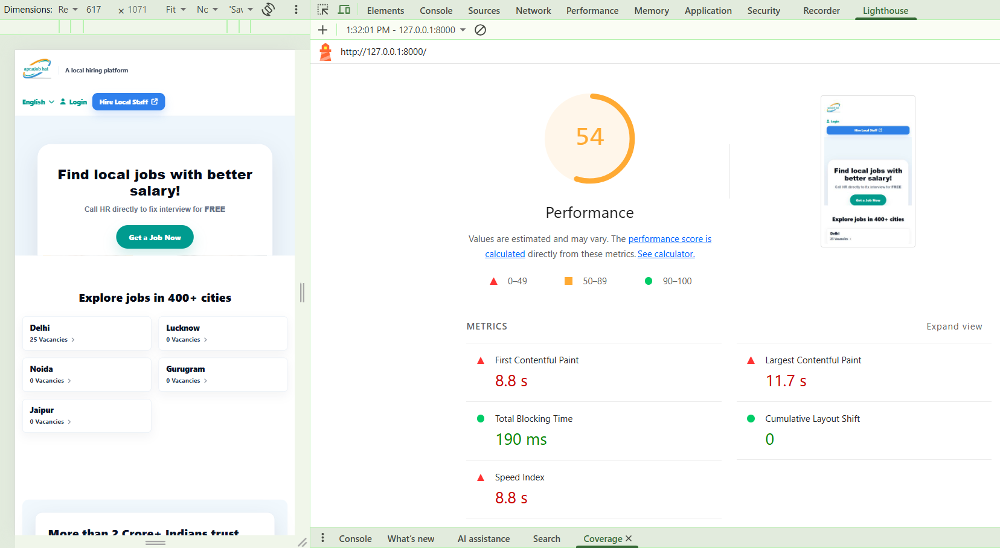
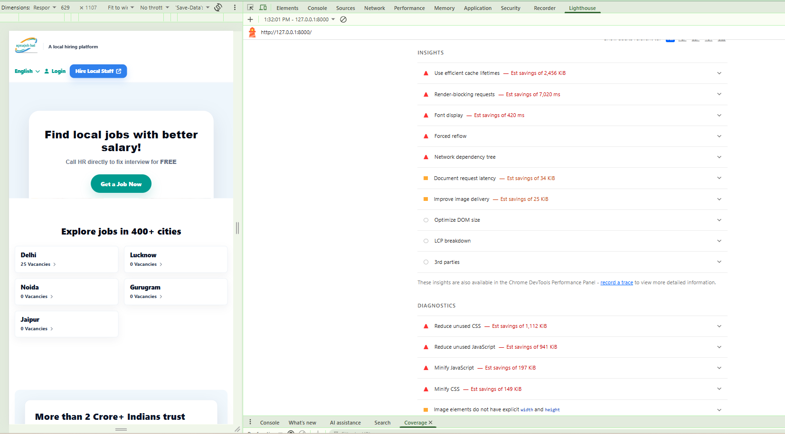
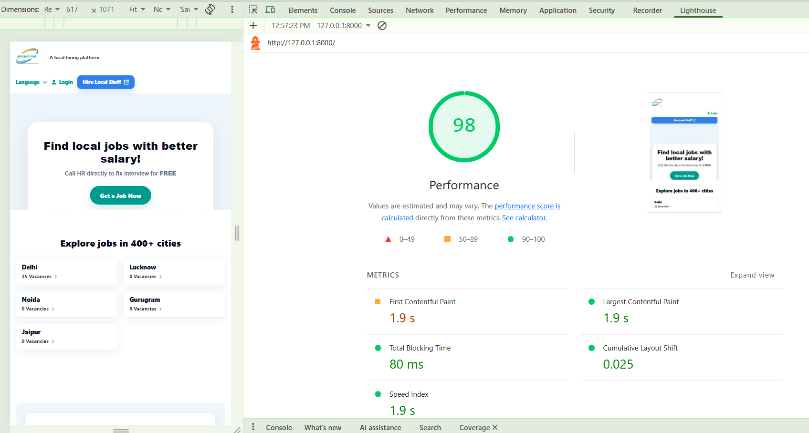
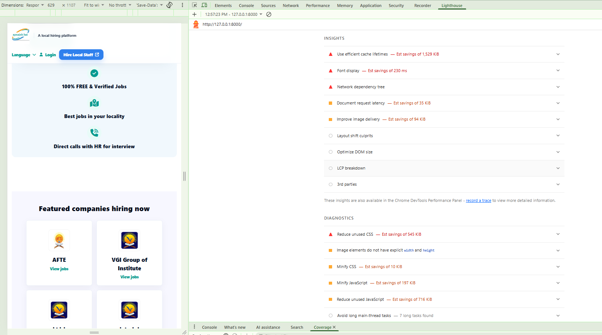

# ApnaJobHai – Technical SEO & Performance Optimization

## Project Overview

This case study documents technical SEO and website performance optimization work performed on the ApnaJobHai website as part of practical industry experience.

**Focus:** Lighthouse performance, Core Web Vitals, frontend resource loading, image delivery and technical auditing.

## Performance Improvement

The following results were recorded during local Lighthouse testing.

| Metric | Before Optimization | After Optimization |
|---|---:|---:|
| Performance Score | 54 | 98 |
| First Contentful Paint (FCP) | 8.8 s | 1.9 s |
| Largest Contentful Paint (LCP) | 11.7 s | 1.9 s |
| Total Blocking Time (TBT) | 190 ms | 80 ms |
| Cumulative Layout Shift (CLS) | 0 | 0.025 |
| Speed Index | 8.8 s | 1.9 s |

**Performance score improvement: 44 Lighthouse points.**

*Note: These results were recorded using Lighthouse on the local development website. Scores and metrics may vary between test runs and testing conditions.*

## Before & After Evidence

### Before Optimization

**Performance Score: 54**

### After Optimization

**Performance Score: 98**

## Issues Identified During the Initial Audit

The initial Lighthouse report highlighted several performance opportunities:

- Slow First Contentful Paint and Largest Contentful Paint.
- Render-blocking CSS and JavaScript resources.
- Unused CSS and JavaScript.
- Inefficient cache lifetimes.
- Font loading optimization opportunities.
- Image delivery and asset-loading improvements.
- Large overall network payload.

## Optimization Work

The work involved:

1. **Performance Auditing**
   - Analysed Lighthouse reports and performance metrics.
   - Used Chrome DevTools to inspect frontend resources.
   - Identified render-blocking resources and unused assets.

2. **CSS & JavaScript Optimization**
   - Reviewed CSS and JavaScript loading.
   - Worked on reducing unnecessary frontend resource loading.
   - Used minified CSS assets where applicable.

3. **Image & Asset Optimization**
   - Reviewed image delivery and oversized assets.
   - Worked on image compression and asset loading.
   - Reviewed unnecessary icon and font resources.

4. **Caching & Font Loading**
   - Worked on browser caching configuration.
   - Reviewed font-display behaviour and font loading.
   - Evaluated resource-loading improvements through Lighthouse.

## Remaining Opportunities

The final Lighthouse report still identified opportunities to improve:

- Unused CSS and JavaScript.
- Image elements without explicit width and height.
- CSS and JavaScript minification.
- Cache lifetimes and font loading.

## Tools & Technologies

- Google Lighthouse
- Google PageSpeed Insights
- Chrome DevTools
- Laravel / PHP
- HTML
- CSS
- JavaScript
- MySQL
- Visual Studio Code

## Key Learnings

- Understanding and analysing Core Web Vitals.
- Identifying performance bottlenecks through Lighthouse.
- Optimizing frontend assets and resource loading.
- Comparing performance before and after optimization.
- Understanding the impact of caching, CSS, JavaScript and image delivery.

## Project Status

Technical SEO and performance optimization work documented as a case study.

This repository contains project documentation and permitted screenshots only. The company's proprietary source code, database and credentials are not included.